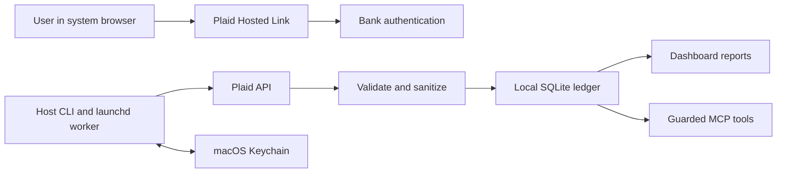

# Plaid bank synchronization design

Date: 2026-10-10

Status: Accepted for implementation planning on 2026-10-10

Scope: Single-user macOS host connector for continued bank transaction updates

## Purpose and recommendation

Connect selected bank and credit card accounts to the existing local ledger,
keep posted transactions current, and preserve user categories and audit history.
Use a host CLI, Plaid Hosted Link, macOS Keychain, and scheduled cursor polling.
The dashboard container and MCP server receive sanitized financial facts and
connection health; they receive no Plaid credentials or management capability.

The user requested a detailed design with security foremost. This specification
defines the proposed behavior; it does not authorize connecting a bank, changing
live history, enabling a schedule, purchasing access, or deploying code.

## Requirements and boundaries

1. New transactions, provider corrections, and removals reach the ledger without
   duplicate spending or lost updates.
2. Authentication occurs in the user's browser through Plaid. The app never
   collects bank passwords, MFA codes, or authenticator secrets.
3. Secrets stay outside the ledger, general settings, dashboard, MCP responses,
   logs, launchd plists, Git, and database backups.
4. Account mapping and historical overlap are reviewed before ingestion starts.
5. Routine sync is deterministic and needs no AI call or human approval per run.
6. Existing reports remain usable during outages and show stale/incomplete data.
7. Manual categorization remains an agent-permitted derived operation; imported
   facts, provider mappings, and cursor state remain agent-immutable.
8. A real-bank pilot must demonstrate unattended Keychain access and exact
   statement reconciliation before enabling automatic ingestion.

Assumptions: a logged-in macOS user runs the host connector; the ledger remains
on that host; initial accounts use USD; the chosen institutions support Plaid
Transactions. Bank names and country are enrollment inputs, not blockers to
designing the subsystem. Any other currency is rejected explicitly in v1.

Excluded: payment initiation, routing/account-number retrieval, identity data,
investment transactions, cloud financial storage, public webhooks, dashboard
bank management, generic multi-provider abstractions, and real-time alerts.
Pending charges do not appear in v1 spending totals.

## Repository facts affecting the design

| Current behavior | Design consequence |
| --- | --- |
| `ingest/importer.py` deduplicates by `(account_id, fitid)` and flags changed facts | Plaid needs explicit provider mappings and its own update orchestrator |
| `accounts.acct_hash` derives from statement bank/account identifiers | Provider account IDs must map to existing local accounts |
| `db.agent_connect()` permits reads except listed private columns | New private tables require table-wide read denial |
| The agent can read and write `settings` | Tokens, cursors, mappings, and security controls cannot live there |
| `effective_txns` uses split values in place of parent amounts | Changed amounts must invalidate incompatible splits atomically |
| File undo and reconciliation can delete transaction rows | Those paths must refuse operations involving Plaid-managed rows |
| Container intake restriction covers three specific routes | Plaid management stays out of the ordinary dashboard router |
| Backups are permission-restricted SQLite copies | Keep credentials outside the DB; backups still contain sensitive financial data |

Relevant files: `src/local_budget/db.py`, `ingest/importer.py`, `intake.py`,
`reconcile.py`, `splits.py`, `reports.py`, `backup.py`, `web/server.py`,
`connectors/amazon/match.py`, `connectors/walmart/match.py`, and `ops/README.md`.

## Architecture alternatives

| Approach | Benefits | Costs and risks | Decision |
| --- | --- | --- | --- |
| Host CLI with scheduled outbound polling | Reuses host ingestion model; no incoming endpoint; credentials outside container | Host must be awake; provider freshness limits remain | Recommended |
| Public webhook receiver plus host worker | Provider notifications can trigger prompt fetches | Public HTTPS service, signature verification, replay handling, queue, operational ownership | Deferred |
| Connector inside dashboard container | Can run while host user session is absent | Adds credentials and bank management to network-facing process | Rejected for v1 |

Polling retrieves provider-held updates; it does not force the bank to refresh.
Webhooks can be added later as wake-up signals without changing cursor semantics.
They would require a separate reviewed design and deployment authorization.

## Security model

### Protected assets and threats

Assets include API credentials, persistent Item tokens, temporary linking
credentials, account relationships, transaction facts, user annotations, and
the integrity of spending totals.

The design addresses accidental Git/log leakage, malicious browser requests,
network interception, unexpected provider data, prompt injection in merchant
text, overlapping imports, concurrent writers, failed pagination, and stale
backup recovery. All transport uses certificate-verified HTTPS to fixed Plaid
environment hosts; callers cannot supply arbitrary API URLs. Browser-launch
URLs must be HTTPS on the documented Plaid Hosted Link host, with no embedded
credentials. HTTP debugging and request/response body logging are disabled.

Keychain is not isolation from hostile software with the same user's privileges.
The MCP SQL authorizer protects tool access, not an agent with unrestricted shell
access to the host. The mounted dashboard ledger also contains financial facts
and private connector metadata; withholding Keychain protects credentials but
does not make that metadata confidential from the container's own process.
Stronger isolation requires a dedicated service identity and separately scoped
storage. That is a consequential deployment change outside v1.

### Credential storage

Use macOS Keychain through a maintained native binding, with narrowly scoped
service/account labels containing environment, a persisted ledger namespace,
and opaque local handles. Restores preserve that namespace; a separate Sandbox
ledger uses a different namespace. Do not
invoke `security` with secret values in command arguments or shell interpolation.
Choose and verify the smallest supported binding during implementation; no
custom encryption scheme or automatic plaintext fallback is permitted.

Store the provider secret, Item access tokens, and resumable Link tokens there.
Store client ID and nonsecret environment configuration in an owner-only connector
configuration file outside agent-writable settings. Provider identifiers and
Keychain references are private DB metadata, not authentication secrets.

Keychain access must work from the pinned host executable under the real
LaunchAgent. Interactive setup may prompt; scheduled jobs cannot prompt and must
return `credential_locked` or `credential_missing`. Upgrading the executable may
require renewing Keychain permissions. Do not grant indiscriminate credential
access to arbitrary applications as a workaround.

The host should use disk encryption; financial backups need equivalent protection.
Directory/file permissions follow existing 0700/0600 rules. Neither permissions
nor account masking constitute encryption or anonymization.

### Agent and dashboard access

Add an explicit private-table set to the SQLite read authorizer. Deny every
column of each private connector table, including future added columns. Leave
the existing write allowlists narrow. Tests must check direct SQL, joins, views,
`SELECT *`, and write predicates against private data.

Publish health through a safe table `plaid_status_public`, maintained in the
same transactions as connection state. Its allowlisted fields are local account
ID, state enum, last attempt, last commit, provider freshness timestamp, history
readiness, and review counts. No provider IDs, cursors, credential references,
raw error messages, or financial descriptions appear in this table.

The agent cannot write this table. A deterministic read tool joins it to local
account nicknames. If the dashboard displays status, it uses the same safe
projection and existing API authentication. No Plaid management routes or
credentials are added to the container, and no network activity occurs merely
because an agent asks for a report.

### Data minimization and logs

Persist date, exact signed cents, supported currency, redacted description,
normalized merchant, transaction ID mapping, and minimal lifecycle facts.
Do not retain full API responses, owner/contact information, precise location,
bank account/routing numbers, browser cookies, or Link event transcripts.
Descriptions are untrusted data: reuse existing redaction and normalization,
escape dashboard output, and never interpret text as instructions.

Logs may include local connection handle, enum error code, HTTP status, Plaid
request ID, counts, duration, and timestamps. Do not interpolate arbitrary
exception strings. A provider error maps to a known safe enum or
`provider_error`; the original response is discarded. Historical previews are
interactive financial output, not scheduled logs.

## Linking lifecycle

`budget plaid setup --environment sandbox|production` takes hidden credential
input, validates secure storage, and saves no secret through argv or stdout.
Production linking requires an explicit environment selection and presents
which data will be shared with Plaid before opening the browser.

`budget plaid link` creates a single-bank Hosted Link session with
`products=[transactions]`, the applicable country, a random stable local user ID,
and `hosted_link` configuration. Use a 15-minute link lifetime. Omit SMS/email
delivery, public webhooks, and application completion redirects. Validate this
desktop Hosted Link flow with an OAuth bank during the live pilot.

Store the Link token in Keychain and a nonsecret session receipt before opening
the URL. Poll `/link/token/get` at five-second intervals while the command runs,
bounded by expiry and rate-limit backoff. Use results for the locally initiated
session. Multi-Item linking is disabled; unexpected multiple successful Items
stop for recovery rather than being silently ingested.

Exchange a successful public token once, save the access token to Keychain, then
create the disabled Item metadata row. Account mapping and activation follow.
Clear temporary credentials when complete or expired. `link --resume` retrieves
an unfinished session within provider availability limits without creating
another Item. A lost exchange response or a crash before durable token storage
cannot be made atomic with Plaid: report `link_recovery_required`, inspect the
existing connection through Plaid's supported recovery/support paths, and do
not blindly recreate it or assert that it was revoked.

`reconnect <connection>` uses Hosted Link update mode against the existing Item.
Do not run a new public-token exchange for an ordinary successful update-mode
flow. Refresh account metadata afterward; new or changed account identities
require mapping review and remain disabled until mapped.

## Local data model

Use additive migrations, explicit foreign keys, and schema constraints. No real
credentials or bank records belong in migration fixtures.

| Private table | Key and required fields |
| --- | --- |
| `plaid_items` | Local Item ID; unique `(environment, item_id)`; credential reference; user handle; state; cursor; mapping generation; attempt/commit/provider-update timestamps |
| `plaid_link_sessions` | Local session ID; environment; credential reference; expiry; mode; optional existing Item; completed flag |
| `plaid_accounts` | Local Item + provider account ID; mapped local account ID; currency/type; enabled flag; inclusive start date; history approval state |
| `plaid_transactions` | Local Item + provider transaction ID; provider account ID; nullable local txn ID; active-owner flag; disposition; minimal latest normalized facts |
| `plaid_sync_runs` | Local run ID; Item; start/end; outcome; counts; safe error enum; request ID; initial/historical readiness |
| `plaid_changes` | Local change ID; run; local txn ID; event kind; redacted before/after facts; archived invalidated splits/match references |

`plaid_transactions` also remembers ignored pending and pre-transition rows, so a
later modification can be evaluated using the latest facts. It never stores full
payload JSON. Transaction identity is scoped to Item; raw IDs are not assumed
globally unique across environments or independent connections.

Provider-only accounts receive a local identity derived from a namespaced
provider key, not a fabricated bank account number or last-four value. Existing
statement accounts keep their existing identity and get an explicit mapping.
One local account has at most one enabled Plaid source. A partial unique index
permits at most one active provider owner per local transaction, while retaining
inactive historical provider mappings. Relinking a replacement Item requires
overlap review because provider IDs may change.

Replacement activation explicitly transfers ownership: lock old and new Items
in ascending local-ID order, then intake; disable the old source; match replacement
IDs through reviewed one-to-one adoption; and atomically mark old transaction
mappings inactive and new mappings active in `BEGIN IMMEDIATE`. Keep old identity
and audit records. Never create a second ledger row for an adopted charge. Late
events or replay from the retired Item cannot mutate rows it no longer owns.
Unresolved replacement overlap leaves the new source disabled.

Plaid rows use namespaced FITIDs as an additional uniqueness guard, but
`plaid_transactions` is the authoritative source mapping. Source-managed rows
are not assigned to undoable file-import batches. Foreign keys from provider
maps to ledger rows use `RESTRICT`, with deliberate management operations only.

## Account mapping and historical transition

After linking, ingestion is off. `accounts` lists institution, account type,
masked identifier, and user-friendly name. `map <provider-handle> <local-account>`
is interactive and verifies type/currency compatibility. Last-four matching may
suggest an account but never activates a mapping automatically.

Request 90 days of initial provider history in v1. Existing exports remain the
source for older history. An explicit history request can be configured before
linking, within provider limits, but never creates a replacement Item automatically.

`preview` fetches a complete batch without advancing the committed cursor or
changing the ledger. It shows returned coverage, readiness, statement coverage,
candidate overlaps, proposed start dates, and exact incoming totals. It stores
no plaintext preview file by default.

For an already imported account, choose an inclusive Plaid start date after the
last reviewed complete statement period. Date selection requires confirming
there is no uncovered gap; it is not inferred from the latest transaction date.
Provider rows before that boundary are tracked as excluded, not inserted.
This intentionally leaves corrections to older statement-only history to manual
reconciliation. A later date change is permitted only through another preview
and reviewed backfill.

Within the selected period, unresolved overlap disables activation. A unique
merchant/date/amount candidate is advisory evidence. Explicitly adopting an
existing row requires a one-to-one match and approval of Plaid ownership for
future facts. Ambiguous identical charges must remain distinct until resolved.
Activation records the mapping generation and transition decision, then performs
a fresh full sync; it never applies a stale preview blindly.

Future file imports for a Plaid-enabled account may cover only dates before the
approved boundary. Any forbidden overlap rejects the entire file with an
actionable safe error, preserving the importer's existing all-or-nothing behavior
for multi-account files; rows are not silently discarded or duplicated. Generic
file undo/reconcile refuses a batch or action affecting any provider-mapped row.
These guards apply through CLI, dashboard, and MCP entry points.

## Sync algorithm and concurrency

1. Acquire an Item lock covering sync/reconnect/disconnect and read the Item's
   cursor and mapping generation. Scheduled lock contention is a safe skip.
2. Fetch every `/transactions/sync` page with verified TLS and explicit timeouts.
   Use one cursor stream per Item, not a mixture of per-account and Item streams.
3. Keep the original cursor until pagination completes. On mutation during
   pagination, discard the batch and restart from that cursor. Limit restarts to
   three; leave the old cursor on exhaustion.
4. Validate a bounded batch (500 records per page; at most 50,000 updates per
   run and 64 MiB of response data). Exceeding limits fails visibly with no partial
   commit; raise the limit through reviewed configuration if legitimately needed.
5. Process event ordering deterministically. Preserve per-page sequence and use
   Plaid lifecycle semantics; never infer a removal from absence in a response.
6. Acquire the existing intake mutex for application, then open a SQLite
   `BEGIN IMMEDIATE` transaction before reading any facts used to validate the
   write. Recheck Item state, cursor, mapping generation, and ownership.
   If any changed, discard/refetch rather than apply against stale configuration.
7. Apply facts, mappings, dependent-data invalidations, audit entries, health,
   and the new cursor together. Commit once. Release locks in reverse order.

Network operations occur outside a SQLite write transaction. Direct file imports,
reconciliation, and split/category writes must use `BEGIN IMMEDIATE` before
dependent validation reads, or a tested equivalent compare-and-retry operation.
In particular, a split operation must lock before reading its parent amount and
keep that lock until its writes commit: a deferred transaction started only at
the first DML statement leaves a validation/write race. Provider ownership checks
must likewise occur inside the protected transaction. Schema/ownership
guards, rather than just the intake mutex, protect routes that lack that mutex.
Mapping mutations take the Item lock; locks are always Items in ascending
local-ID order, then intake. A normal sync needs only its own Item lock.

HTTP retries: at most three for rate limits and transient transport/server errors,
with jitter, bounded `Retry-After`, and a five-minute scheduled-run deadline.
Authentication/consent failures do not retry. Fixed timeouts bound individual calls.
Each Item fails independently so an unhealthy bank does not stop other banks.

Normalize JSON amounts with Decimal directly, negate Plaid's outflow-positive
convention, and use the existing cents converter. Do not multiply binary floats
or silently round sub-cent values. Dates remain provider-supplied ISO dates;
do not reinterpret them through the Mac timezone. Reject malformed facts,
non-USD currency, account mismatches, and unrecognized lifecycle values.

## Transaction lifecycle and derived data

| Event | Ledger behavior |
| --- | --- |
| Added posted row in an approved account/date range | Insert once, sanitize, categorize with existing rules, record provider mapping |
| Pending row | Track minimal provider state only; no spending row |
| Pending replaced by posted with a new provider ID | Insert posted row once; pending never counted |
| Modified posted row | Update provider facts in place with stable local txn ID and an audit entry |
| Existing posted row becomes pending | Set non-posted status and revalidate dependent data |
| Removed row | Tombstone mapped ledger row as `removed`; retain mapping and annotations |
| Repeated unchanged row | No extra ledger row or correction event |
| Removed row reappears | Restore/update the same mapped ledger identity when provider identity matches |
| Date correction crosses transition boundary | Reevaluate eligibility from latest facts and audit the resulting inclusion/exclusion |

When normalized merchant facts change, recompute `canonical_merchant` through
the existing alias rules in the same transaction. Invalidate affected historical
normalization undo entries so undo cannot restore obsolete source-derived identity;
do not remove user alias rules. Add an invalidation marker to affected
`normalize_changes` entries. A normalization undo batch containing an invalidated
entry refuses the whole operation with a clear reason; it neither restores stale
identity nor partially removes shared alias rules.

Manual categories and subcategories survive corrections. Rule-derived categories
may be recomputed when normalized merchant or direction changes; user-derived
ones are flagged for review when the correction makes their meaning doubtful.
Refunds and card payments must follow tested existing rules, not the assumption
that all positive local amounts are income.

If amount changes and existing splits no longer sum to the new amount, archive
the old split records in the private audit and remove active splits within the
same commit. The corrected unsplit amount immediately drives reports; expose
`split_needs_review`. Never scale user splits proportionally or retain a wrong sum.
For amount/date/merchant changes, archive and remove affected Amazon/Walmart
matches and connector-generated splits when they no longer meet matching rules.
Do not run merchant network fetches within the bank sync transaction.

Removals are not refunds and do not delete ledger rows. Reports count only
`posted`; removal preserves financial audit and permits replay. The implementation
must audit every report, drilldown, split list, and enrichment report to ensure
non-posted rows cannot remain counted through an unfiltered join.

## Scheduling and observable status

Automation is off by default. After a reconciled pilot, an explicitly installed
LaunchAgent runs `budget plaid sync --all --non-interactive` every six hours and
at login, using an absolute pinned executable, verified data path, restrictive
umask, and safe logs. Plists contain no credentials. Do not run `uv sync`, fetch
dependencies, or upgrade code on each scheduled tick.

The Mac must be awake and the user session active; missed intervals catch up on
the next run. The command exits promptly when offline or Keychain is locked.
One active scheduler is registered per ledger, and manual/scheduled overlap uses
the same Item locks. Installer/uninstaller affects only this job.

The worker calls `/accounts/get` during discovery/reconnect and `/item/get`
for connection health and provider freshness. A missing account from a sync
page does not prove revocation; unknown accounts trigger discovery and stay
disabled. No `/transactions/refresh` or other extra-product endpoint is called
by the schedule. Safe health failures retain the last successful timestamps.

States: `disabled`, `awaiting_mapping`, `awaiting_history_review`, `initializing`,
`healthy`, `temporary_error`, `reconnect_required`, `credential_locked`,
`credential_missing`, `link_recovery_required`, `revocation_pending`, `revoked`.

Show local attempt time, committed fetch time, provider update time when
available, historical completeness, excluded account count, and review count.
Historical initialization is complete only when `transactions_update_status`
reports `HISTORICAL_UPDATE_COMPLETE`; `INITIAL_UPDATE_COMPLETE` is incomplete
history, and unknown/not-ready values remain initializing. An empty successful
first fetch is not proof. Missing freshness data
is shown as unknown. Flag stale data after 48 hours without a confirmed provider
update (or local commit when provider time is unavailable), separately from errors.
Safe status participates in CLI/MCP reports without causing network activity.

## Revocation, incident response, and restore

`disconnect` requires an explicit host action, acquires the Item lock, records
`revocation_pending`, and immediately disables local syncing. Call `/item/remove`;
only after a confirmed success delete the Keychain token and mark `revoked`.
If the remote result is uncertain, retain the credential for recovery and show
that remote revocation is unconfirmed. Never claim local deletion revoked access.
Removing an Item keeps historical financial data; deleting that data is separate.

Ordinary reconnect uses update mode. Token rotation is a manual incident/recovery
action, not an automatic timer: it invalidates the old token immediately and
requires durable handling of the new one. A lost rotation response triggers
recovery, not silent creation of a replacement Item.

Database backups include ledger, mappings, cursor, and private audit, but not
Keychain secrets. Stop scheduled sync before a restore; restore the whole
consistent database, verify environment and credential references, then resume
from its saved older cursor. Provider-ID mappings make replay idempotent. If the
provider rejects a cursor, disable automatic ingestion and preview a full rebuild
against existing mappings. Lost Keychain tokens require supported recovery or an
explicit replacement connection plus overlap review. Do not store secret exports
beside ordinary backups.

For suspected credential compromise: pause sync, revoke the affected connection,
rotate the provider secret as appropriate, inspect safe request IDs and audit
counts, and reconnect only after secure storage is restored. Logs never serve
as a hidden credential recovery store.

## Components and integration scope

| Proposed component | Responsibility |
| --- | --- |
| `connectors/plaid/client.py` | Fixed-environment HTTP client, Decimal parsing, bounded requests, safe errors |
| `connectors/plaid/credentials.py` | Native Keychain operations; no plaintext fallback |
| `connectors/plaid/link.py` | Hosted Link session lifecycle, exchange, update-mode recovery |
| `connectors/plaid/store.py` | Private mapping/state persistence and safe health projection |
| `connectors/plaid/sync.py` | Pagination, validation, atomic ledger changes and invalidations |
| Existing `cli.py` | Host commands and explicit activation/revocation prompts |
| Existing `db.py` | Additive schema/migrations, private-table denial, ownership constraints |
| Existing importer/intake/reconcile/normalize | Statement boundary and managed-row guards; invalidated normalization undo checks |
| Existing split/enrichment helpers | Transaction-scoped invalidation shared with bank updates |
| Existing report/MCP layer | Safe freshness and review information, complete posted-status filtering |
| `ops/` | Explicit schedule installation and deterministic host wrapper |

Use a small dedicated HTTP client with a maintained HTTP library and Decimal
JSON decoding rather than copying the Plaid Quickstart or introducing a frontend
framework. Add only the HTTP and Keychain dependencies required by the connector,
locked through the existing dependency workflow. No unrelated redesign of the
dashboard, importer, authorizer, or merchant connectors is in scope.

## Validation and release criteria

Tests use fabricated data and mocked HTTP/Keychain by default. No bank data,
credentials, or institution-owned screenshots enter fixtures or CI.

| Area | Required observable checks |
| --- | --- |
| Confidentiality | Secret sentinels absent from DB, backup, logs, exceptions, CLI JSON, MCP, dashboard and staged files |
| Access control | Every private table denied through direct/join/view reads; mappings/cursors not agent-writable; public health read-only |
| Link | Expiry, cancellation, resume, wrong session/environment, duplicate result, exchange/storage failure, update mode |
| Accounting | Outflow signs, Decimal cents, currency rejection, refunds/transfers, identical legitimate purchases, transition overlap |
| Sync reliability | Multiple pages, mutation restart, limits, rate limiting, failure before commit, crash after commit, replay, concurrent runs |
| Corrections | Stable local IDs, manual category preservation, split/enrichment invalidation, canonical merchant recomputation and normalization undo, removals/reappearance |
| Existing writes | Whole-file overlap rejection; undo/reconcile ownership guards; concurrent correction versus split validation |
| Replacement connections | One-to-one ownership transfer without duplicate spend; late retired-Item replay cannot alter new-owned rows |
| Operations | Locked Keychain under launchd, offline run, stale state, initial history incomplete, revocation uncertainty, older-backup replay |
| Regression | Existing import, reconciliation, reports, agent authorizer, Amazon/Walmart and split tests remain passing |

Run targeted tests first, then the repository's required CI checks. Review staged
files and content for secrets; the existing filename-only commit guard is useful
but insufficient by itself. Visually verify any added dashboard status display.

Rollout order: secure storage/schema → Sandbox linking and sync → mappings and
preview → one manually synced Production bank → reconciled statement period and
launchd credential test → explicitly enabled schedule → additional reviewed banks.
Production enrollment remains disabled if any security or accounting acceptance
criterion fails. Deliver implementation through a feature branch and draft PR;
merging/deployment and live-data enrollment remain separately authorized actions.

## Decisions for the user review

The recommended baseline is host-only macOS polling, Keychain storage, USD-only
posted transactions, 90-day requested initial history, explicit transition dates,
and six-hour scheduling enabled after a successful pilot. A dedicated service
identity, other currencies, earlier API-owned history, or always-on execution
requires adjusting the design before implementation.

## External contracts

Provider behavior below is distinct from the local design decisions above.

- Hosted Link supports API retrieval of session results, including public tokens;
  completed session detail is available for six hours. Webhooks are recommended,
  not the only retrieval path. [Hosted Link](https://plaid.com/docs/link/hosted-link/)
- Sync returns cursor-based changes; pagination mutation requires restarting from
  the original cursor. Transaction amounts use outflow-positive signs. Initial
  history is institution-dependent and requestable up to 730 days.
  [Transactions API](https://plaid.com/docs/api/products/transactions/)
- Ordinary update mode preserves the Item token. [Update mode](https://plaid.com/docs/link/update-mode/)
- Item removal and access-token rotation are distinct remote operations.
  [Items API](https://plaid.com/docs/api/items/)
- Production OAuth redirects require HTTPS if an embedded Link flow is used.
  [OAuth](https://plaid.com/docs/link/oauth/)
- Eligible new US/Canada Trial teams can create ten Production Items; deletion
  does not restore slots. Paid product use requires reviewing actual rates.
  [Billing](https://plaid.com/docs/account/billing/)
